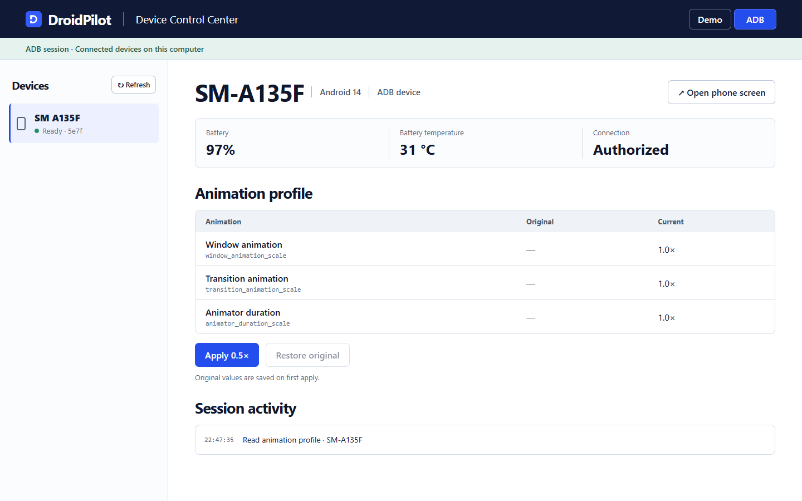

# DroidPilot · Android Device Control Center

DroidPilot is a local Android engineering console. Select an authorized handset, inspect its battery and animation settings, change all three animation scales, and restore their exact original values. Open a scrcpy window to control the selected device from your computer. The Python CLI also triages crashes and times app launches. This is a new AI-assisted portfolio project.



*Live ADB inspection of the Samsung handset. All three current values came from the phone. The short identifier beside Ready is a temporary session label.* [Simulated apply and backup example](docs/media/dashboard-demo.png)

The live demo applies the 0.5× profile twice, verifies that the original values are preserved, and restores all three settings. The same handset completed ten force-stop-based Display Settings launches with a median of 1,181.5 ms. [Watch the 85-second Samsung demo](docs/media/samsung-adb-demo.mp4) · [Handset evidence and timing data](docs/handset.md)

## Run the dashboard

From the repository root in PowerShell, run the following with Python 3.10+. The production React bundle ships with the project.

```powershell
$env:PYTHONPATH = "src"
python -m droidpilot dashboard
```

**One-minute walkthrough.** In **Demo**, select Pixel 8, click **Apply 0.5×** and confirm. Apply a second time and compare the Original and Current columns. Click **Restore original** and check the verified values and session activity. Switch to **ADB** to list devices from your own computer. Select the handset explicitly, then use **Open phone screen** if scrcpy is installed. Stop the local server with Ctrl+C.

The ADB mode needs Android Platform Tools on PATH. Screen mirroring also needs scrcpy on PATH. The dashboard binds to the loopback interface on the printed port. ADB serials stay on the host, and browser requests use per-session device handles. Demo runs share the same animation transaction logic with a simulated settings provider and an isolated temporary backup directory. [scrcpy installation](https://github.com/Genymobile/scrcpy)

**Try crash triage offline.** In the same shell, choose a fresh output filename and run

```powershell
python -m droidpilot crash --input examples/simulated-crash.log --output crash-report.md
Get-Content crash-report.md
```

The fixture contains one fatal exception. The parser finds a missing note ID and points to `NoteScreen.kt:42`. The generated report identifies its input as simulated. [Expected report](examples/expected-report.md)

## Features and verification

| Tool | What a reviewer can inspect | Local verification |
| --- | --- | --- |
| Device Control Center | Selected-device inspection, battery readout, confirmed tweaks and scrcpy launch | React browser tests, loopback API integration tests and a real UI screenshot with simulated input |
| ADB Doctor | Connection states, USB authorization guidance, model and Android release | Mock transport and missing-ADB CLI check |
| Animation | Per-device original values, verified writes, rollback and exact restore | Stateful mock settings provider |
| Crash Triage | Multiple fatal events, cause chains and source locations | Simulated file through the real CLI and mock device capture |
| Startup Timer | One CSV row per attempt, metadata and median of successful launches | Mock activity-manager responses |
| Magisk Boot Report | Private, module-local reports and retention of ten completed files | ZIP integrity and POSIX syntax checked. Device run pending |

The toolkit connected to a Samsung SM-A135F running Android 14 over wireless ADB and read the three animation scales, model, Android release and battery telemetry. Each feature's validation scope is recorded separately. [Handset observations](docs/handset.md) · [Evidence checklist](docs/evidence.md)

## Windows installation

For Wi-Fi on Android 11 or later, open **Wireless debugging → Pair device with pairing code** on your phone. In the PowerShell session with `PYTHONPATH=src` and Platform Tools on PATH, run `python tools/pair_wifi.py`. Enter the pairing IP and port first, then enter the six-digit code at the ADB prompt. If the device needs a separate connection, use the address on the main Wireless debugging screen. The dashboard identifies devices by their current ADB transport address, so complete any animation restore before switching transports. [Android wireless debugging](https://developer.android.com/tools/adb#connect-to-a-device-over-wi-fi)

Use Windows 10/11 and Python 3.10+. Device commands also require Android SDK Platform Tools on PATH and an owned or authorized phone with USB debugging enabled. A data-capable USB cable and any required manufacturer USB driver connect the phone. Unlock the screen to approve the computer's RSA fingerprint. The simulated crash demo only needs Python. [Android Platform Tools](https://developer.android.com/tools/releases/platform-tools)

From the repository root, create an isolated environment and install the CLI in editable mode. These commands work without activating the environment.

```powershell
python -m venv .venv
.\.venv\Scripts\python.exe -m pip install -e .
.\.venv\Scripts\python.exe -m droidpilot --help
.\.venv\Scripts\droidpilot.exe doctor
```

For the remaining examples, set a short path to the installed interpreter. Find the serial privately with `adb devices -l`. Enter it via the prompt so screenshot commands can display a variable instead of a serial.

```powershell
$py = ".\.venv\Scripts\python.exe"
$serial = Read-Host "Test device serial"
& $py -m droidpilot doctor --serial $serial
New-Item -ItemType Directory -Force private | Out-Null
```

## Animation demo

Read the original scales, set all three animation durations to 0.5×, apply again, then restore. The second apply exercises the original-backup guarantee. Compare each restored value with the first output. Use a test device that permits ADB global settings writes.

```powershell
& $py -m droidpilot animation show --serial $serial
& $py -m droidpilot animation apply --serial $serial
& $py -m droidpilot animation apply --serial $serial
& $py -m droidpilot animation restore --serial $serial
```

Each change prompts for approval. An operator can explicitly approve the displayed action with `--yes`. Originals are kept under `%LOCALAPPDATA%\DroidPilot\backups` on Windows and the XDG state directory on Linux. Keep the same host account and ADB serial for restoration. A reboot or disconnection during a write can leave a partial profile. Reconnect, inspect with `show`, then run `restore` to verify the saved values.

## Crash triage

```powershell
& $py -m droidpilot crash --serial $serial --output private\device-crash.md
```

Device capture reads the crash buffer with `logcat -b crash -d`. File input supports AndroidRuntime threadtime and brief text. An application frame must include a source line and match the process package prefix. Custom process names, obfuscation and omitted frames can yield `unknown`. A zero-event report describes the supplied input only. Review exception messages and paths for personal data before sharing. [Android Logcat](https://developer.android.com/tools/logcat)

## Startup timing

Choose an installed test app whose repeated stopping and launching you approve. Replace the example component with its exported activity. A quiet device and consistent screen and power conditions make repeated measurements easier to interpret.

```powershell
$component = "org.example.demo/.MainActivity"
& $py -m droidpilot startup --serial $serial --component $component --runs 10 --output private\runs.csv
```

For each run the CLI calls `am force-stop`, then `am start -W -n`. It records the reported TotalTime in milliseconds. Failed rows have an empty timing and a reason. The metadata file beside the CSV records the model, Android version and component. Choose a fresh output name for a new series. Cache state, background activity and display conditions can affect these measurements. The result describes force-stop-based starts, with no measurement of full interactivity or hardware cache state. [Android startup measurements](https://developer.android.com/topic/performance/issues/launch-time)

## Architecture

```text
src/droidpilot/
  __main__.py    CLI arguments, human approval, dispatch and exit codes
  adb.py         Subprocess transport, timeouts and device selection
  dashboard.py   Loopback HTTP server, same-origin session checks and packaged web assets
  console.py     Device operations, battery parsing, demo adapter and scrcpy lifecycle
  web/           Built React app and static entry point
  doctor.py      Redacted inventory and connection advice
  animation.py   Backup, change, verify, rollback and restore
  crash.py       AndroidRuntime event parser and Markdown rendering
  startup.py     Launch loop, CSV, metadata and median
magisk-boot-report/   Independent module for an existing Magisk test phone
frontend/             React and TypeScript source, build script and Playwright tests
examples/             Simulated crash and its expected report
tests/                Standard-library unittest suite
docs/                 Verification commands and evidence checklist
.github/workflows/    Windows and Linux CI configuration
```

The transport constructs argument lists and addresses device commands with `adb -s SERIAL`. A multi-device inventory needs explicit selection for further inspection. Animation uses a per-device OS file lock and atomically replaces a new backup before the first write. The backup preserves a missing key as JSON null. Restoration deletes that key and verifies the read-back. A failed change attempts to recover the pre-operation state and retains the original backup for retry.

Exit codes are 0 for completion, 1 for an operational error or a partial startup series and 2 for CLI argument syntax errors. Doctor returns 0 when at least one authorized device is present and lists the status of the other connections.

## Tests and optional module

```powershell
& $py -m unittest discover -s tests -v
```

The test suite uses standard-library mocks and temporary directories. GitHub Actions is configured for Windows and Linux on Python 3.10 and 3.12. [Testing notes](docs/testing.md) · [Magisk module guide](magisk-boot-report/README.md) · [Evidence and publication](docs/evidence.md)
