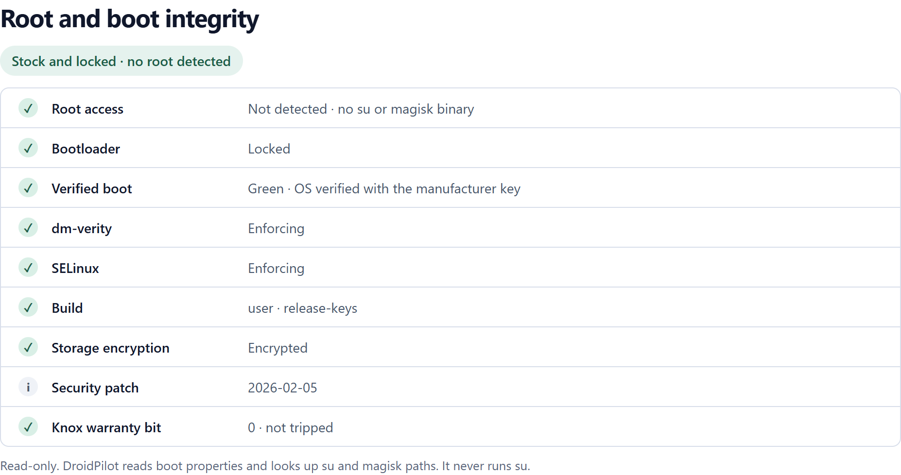
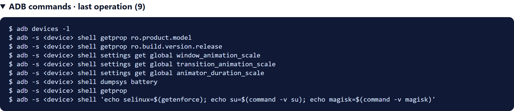

# Root and boot integrity

DroidPilot's `security` command and the dashboard's **Root and boot integrity** panel answer one question before any tweak: what state is this phone's boot chain in? The check is read-only. It reads system properties and looks up the `su` and `magisk` paths with `command -v`. It never runs `su`, so a rooted phone shows no superuser prompt.

```powershell
& $py -m droidpilot security --serial $serial
```

## Result on the test handset

Samsung SM-A135F, Android 14, read over wireless ADB on 24 November 2026:

```text
OK    Root access: Not detected | no su or magisk binary
OK    Bootloader: Locked
OK    Verified boot: Green | OS verified with the manufacturer key
OK    dm-verity: Enforcing
OK    SELinux: Enforcing
OK    Build: user | release-keys
OK    Storage encryption: Encrypted
INFO  Security patch: 2026-02-05
OK    Knox warranty bit: 0 | not tripped
Stock and locked | no root detected
```

The dashboard showed the same nine rows for this phone. The dashboard's **ADB commands** panel lists the commands each operation ran, with the serial replaced by `<device>`.





## What each signal means

| Check | Source | Stock value | What a change indicates |
| --- | --- | --- | --- |
| Root access | `command -v su`, `command -v magisk` | No path | A superuser binary is reachable from the shell. Magisk exposes `su` and `magisk` on PATH for ADB shells |
| Bootloader | `ro.boot.flash.locked`, `ro.boot.vbmeta.device_state` | `1`, `locked` | `0` or `unlocked` means images not signed by the manufacturer can boot |
| Verified boot | `ro.boot.verifiedbootstate` | `green` | `orange` means the bootloader is unlocked and the OS is not verified. `yellow` means a user-installed key signed the OS |
| dm-verity | `ro.boot.veritymode` | `enforcing` | Other values mean read-only partitions are not protected against modification |
| SELinux | `getenforce` | `Enforcing` | `Permissive` disables mandatory access control. Some root setups and custom kernels use it |
| Build | `ro.build.type`, `ro.build.tags`, `ro.debuggable` | `user`, `release-keys`, `0` | `userdebug`, `eng`, `test-keys` or `debuggable` point to a development or custom build |
| Storage encryption | `ro.crypto.state` | `encrypted` | Data is not protected at rest |
| Knox warranty bit | `ro.boot.warranty_bit` (Samsung only) | `0` | `1` means a hardware e-fuse recorded unofficial software. It cannot be reset |

A missing property shows as **Not reported** instead of a guessed value. Root hiding tools can conceal `su`, so a clean result does not prove that a phone has never been modified. The bootloader and verified-boot rows come from the bootloader and are harder to hide.

## How rooting works on a modern Samsung phone

This is the Magisk workflow for a phone like the test handset. I have not performed it on the handset above, for the reasons in the next section.

1. **Allow bootloader unlock.** Enable Developer options, then turn on **OEM unlocking**. On some Samsung phones this switch appears only after the device has been online for a while.
2. **Unlock the bootloader.** Boot into Download mode and choose the unlock option. Unlocking erases all user data.
3. **Patch the boot image.** Download the stock firmware for the exact model and build. Copy the `AP` file to the phone and patch it in the Magisk app. Devices that launched with Android 13 or later use `init_boot` instead of `boot` for the patch.
4. **Flash with Odin.** Flash the patched `AP` with the stock `BL`, `CP` and `CSC` files from the same firmware, then boot and finish setup in Magisk.
5. **Verify.** Rerun `droidpilot security`. Expect Bootloader `Unlocked`, Verified boot `Orange`, Root access with a `su` path and Knox warranty bit `1`.

On Pixel and other phones with `fastboot` the same idea applies: run `fastboot flashing unlock`, patch `boot.img` or `init_boot.img` in Magisk, then flash it with `fastboot flash`.

## Risks and how to undo it

- **Data loss.** Unlocking the bootloader wipes the phone.
- **Knox is permanent.** The Samsung warranty bit stays at `1` after relocking. Samsung Pay, Secure Folder and some banking apps stop working.
- **Play Integrity.** Apps that require strong integrity can refuse to run on an unlocked device.
- **OTA updates.** Updates can fail or remove root. Reapply the patch to the new image.
- **Relocking.** Flash the complete stock firmware first, then relock. Relocking a modified image can leave the phone unbootable.

## Why the test handset is not rooted

The SM-A135F is a daily-use phone. Rooting it would erase its data and trip Knox permanently, and none of the current features need root. DroidPilot uses ADB features that work without root: `settings`, `getprop`, `dumpsys`, `am` and `logcat -b crash`. The [Magisk Boot Report](../magisk-boot-report/README.md) module needs a rooted test device. The next step is to run it on an Android Emulator image rooted with Magisk, or on a spare handset, and record the results in the [evidence checklist](evidence.md).
